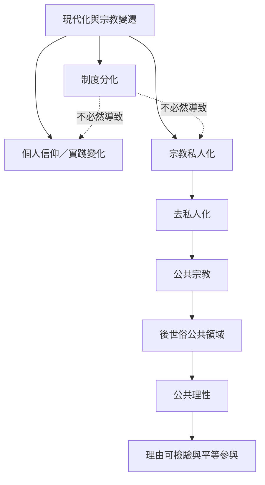

本地圖處理世俗化理論的不同命題，以及宗教重新進入公共領域後，民主公共討論如何調整。制度分化可以持續，而個人信仰與公共宗教也可能維持或增強。

概念：[[世俗化]]、[[去世俗化]]、[[去私人化]]、[[公共宗教]]、[[後世俗]]、[[公共理性]]、[[世俗性]]。

理論筆記：[[世俗化理論應拆分制度分化信仰衰退與宗教私人化]]、[[世俗時代改變的是信仰條件而非單純信仰人數]]、[[後世俗公共領域需要避免宗教語言被單向排除]]、[[宗教公共性不必然否定制度分化]]。
