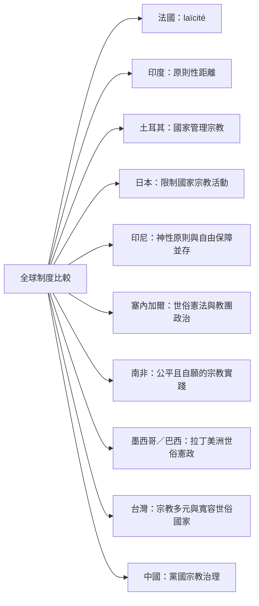

不同國家的世俗制度，應以多個制度維度比較，而不是簡化為世俗／宗教二分。國家是否設立國教、是否管理宗教、如何分配公共資源、如何保障個人良心自由，會形成不同組合。

案例筆記：[[法國1905年政教分離法同時保障良心自由與限制國家宗教特權]]、[[印度以原則性距離回應宗教多元與制度化支配]]、[[土耳其世俗主義以國家管理宗教而非完全退出宗教領域]]、[[日本憲法以宗教自由條款限制國家宗教活動]]、[[印尼在神性國家原則與宗教自由保障之間存在制度張力]]、[[塞內加爾的憲法世俗性與蘇菲教團政治互動並存]]、[[南非以信仰自由與公平自願原則承接宗教多元]]、[[墨西哥的世俗共和國是教會國家衝突與憲政協商的歷史結果]]、[[巴西憲法禁止國家建立宗教但保留公共利益合作空間]]、[[台灣宗教多元與寬容世俗國家提供東亞比較案例]]、[[中國黨國宗教治理不同於自由主義政教分離]]。

比較原則：[[多元世俗主義承認不同社會不會複製同一政教模式]]、[[全球比較研究需要避免把西方經驗當成預設常態]]。
