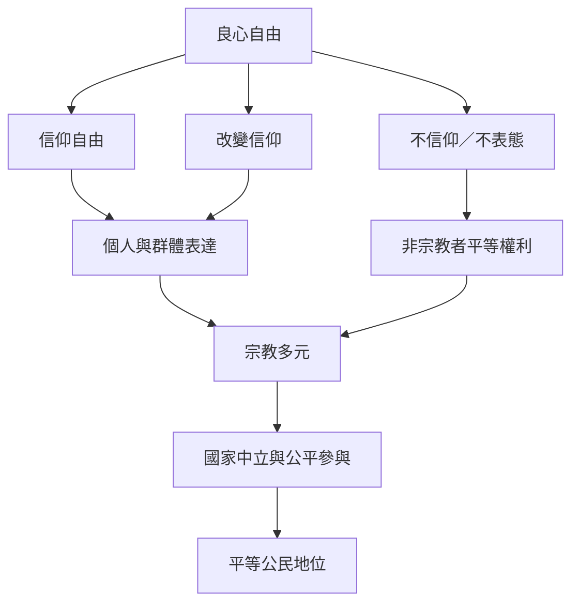

世俗主義的規範基礎之一是良心自由；它同時保護宗教信仰、改變信仰、不信仰與不表態。國家中立、宗教多元與公共合作都應以平等公民地位和防止支配作為檢核。

概念：[[良心自由]]、[[宗教自由或信仰自由]]、[[非宗教]]、[[宗教多元]]、[[國家中立]]、[[國家宗教]]、[[公共理性]]。

論點：[[良心自由同時包含信仰自由與不信仰自由]]、[[多元宗教社會需要平等承認也需要自願參與的制度設計]]、[[非宗教不等於沒有價值實踐或共同生活]]。
