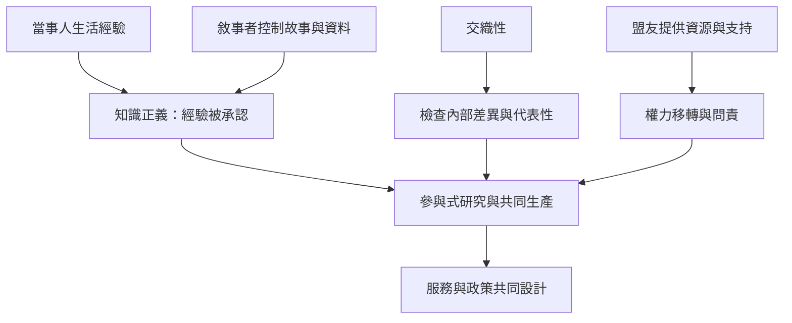

自我倡議需要承認生活經驗的知識價值，也必須處理誰能代表群體、誰的經驗被排除及盟友如何分享權力。交織性分析提醒組織內部並不平等；參與式研究與共同生產則提供共同建立知識及服務的方法。

[[note/生活經驗能揭露制度知識忽略的成本與障礙]]、[[note/交織性決定誰有資源發聲也決定誰容易被代表]]、[[note/盟友支持應逐步增加當事人的領導權而非取代發言]]、[[idea/把個人故事轉成政策建議時保留敘事者的控制權]]、[[term/知識正義]]、[[term/交織性]]、[[term/共同生產]]
