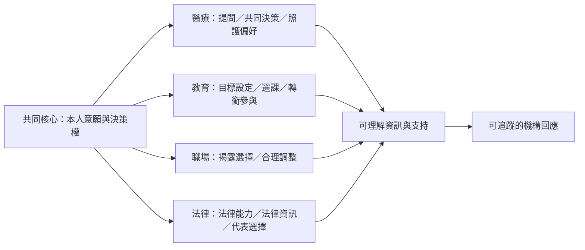

不同場域的倡議工具有所差異，但共同點是讓當事人的目標與偏好進入決策過程，並要求機構提供合理支持。醫療重視資訊理解與共同決策；教育重視學生在課程及轉銜中的選擇；職場重視揭露策略與合理調整；法律場域則需兼顧當事人控制與專業協助。

[[note/醫療自我倡議不應被縮減為患者自我管理責任]]、[[data/學校可透過自我決定教學培養學生表達選擇]]、[[idea/為職場需求準備不必透露完整診斷的表達方式]]、[[data/自我代表與自我決定是法律改革的重要議題]]、[[term/共同決策]]、[[term/合理調整]]
