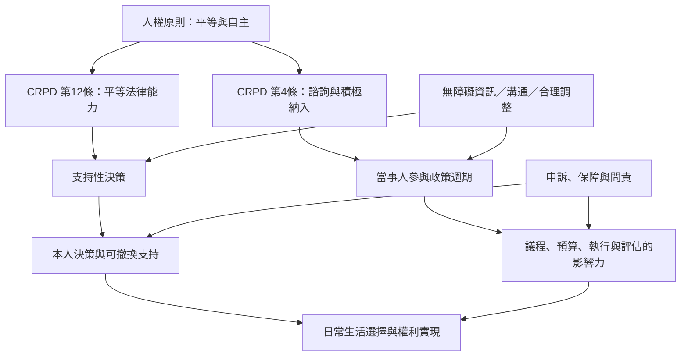

自我倡議需要把人權原則轉化成可被檢查的決策程序。CRPD 第 4 條支持政策參與，第 12 條保障法律能力與支持性決策；實務上還需要無障礙資訊、代表授權、合理調整、申訴及機構回應。

[[note/自我倡議的核心是決策權而不是被邀請發言]]、[[note/支持性決策讓協助者支持選擇而不取代選擇]]、[[note/可及的資訊與行政支持是民主參與的基礎設施]]、[[term/身心障礙者權利公約]]、[[term/支持性決策]]、[[term/程序正義]]
