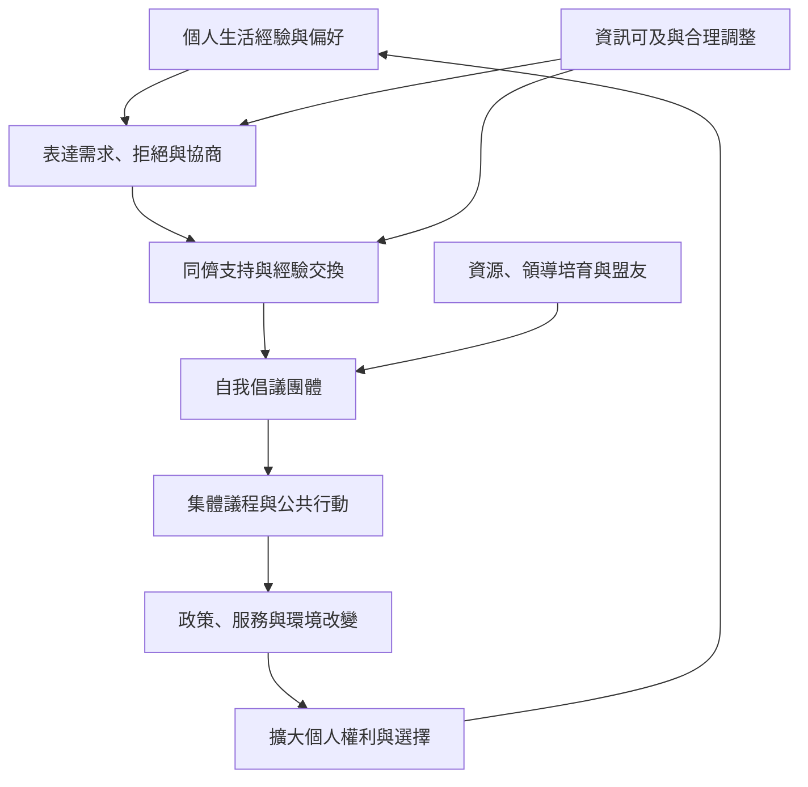

自我倡議可以從一個人表達偏好開始，透過同儕支持累積共同語言，再發展成集體組織與制度改革。各層次不是單向階梯：集體權利保障能擴大個人選擇，個人經驗也能持續修正組織議程。

[[note/自我倡議是一種重新分配決策權的實踐]]、[[note/自我倡議有個人與集體兩個不可互相取代的層次]]、[[note/同儕團體把個人困境轉化為集體政治能力]]、[[term/自我倡議]]、[[term/集體行動]]、[[term/同儕支持]]
