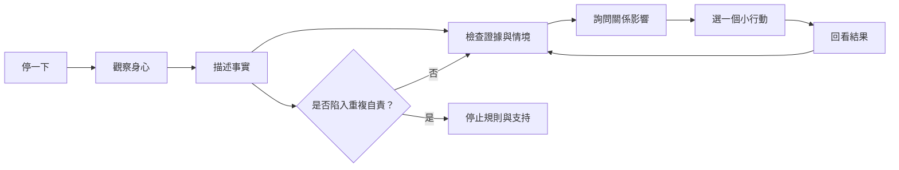

可持續的自我覺察不必靠長時間自我分析，而可透過簡單循環：注意訊號、描述事實、檢視證據、理解關係影響、選擇行動，再檢查結果。此循環既允許內省，也防止內省無限延長。

## 概念連結
[[Self-awareness]]、[[Interoception]]、[[Self-knowledge]]、[[Self-compassion]]、[[Rumination]]、[[Reflected_appraisal]]。

## 參考
[[把自我覺察設計成每日三視角練習]]、[[建立一張自我覺察證據儀表板]]、[[以身體訊號作為暫停習性反應的提示]]、[[建立停止規則避免自我反思滑向反芻]]。
