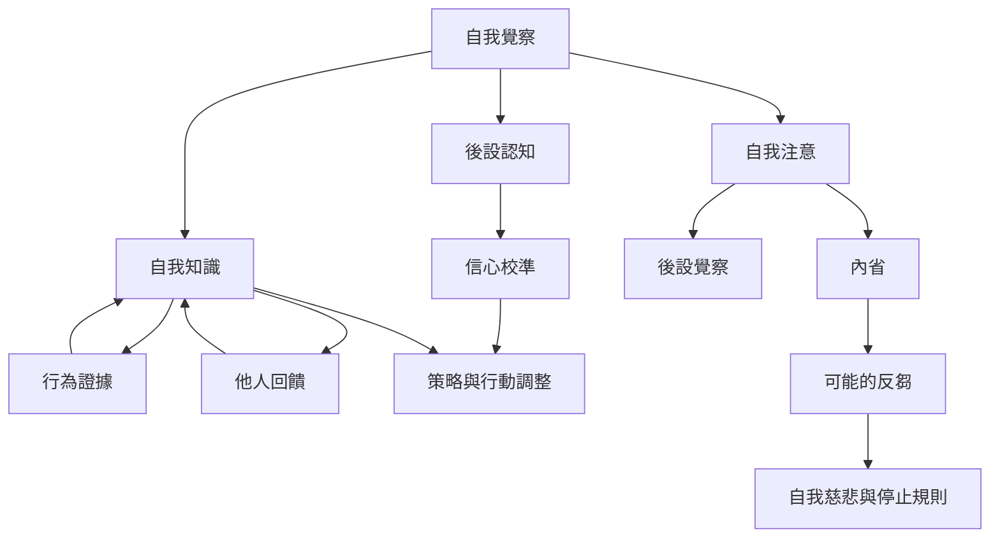

自我覺察可拆解為注意自身、形成自我知識、監測認知信心、接收回饋與調節行動。這張圖把「正在注意什麼」與「對自己的判斷是否可靠」分開，避免把反省頻率當成準確度。

## 概念連結
[[Self-awareness]]、[[Self-knowledge]]、[[Introspection]]、[[Metacognition]]、[[Meta-awareness]]、[[Reflected_appraisal]]、[[Rumination]]、[[Self-compassion]]。

## 參考
[[自我覺察是把自己變成注意對象而非保證看清自己]]、[[自我知識需要內省行為證據與他人回饋互補]]、[[後設認知讓人監測自己的判斷但信心不等於準確]]。
