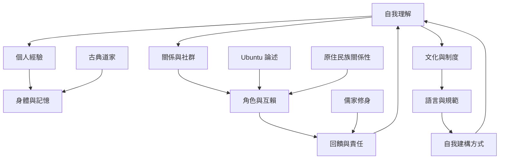

自我並非只由個人內省決定，也透過社會角色、文化語言、照顧網絡、制度與地方關係形成。文化研究提醒我們使用多維度觀點；關係性哲學則從不同傳統說明個人如何在共同生活中形成。圖中不把儒家、道家、Ubuntu 與原住民族知識視為同一理論，而是標記它們共同提醒的關係維度。

## 概念連結
[[Self-construal]]、[[Independent_and_interdependent_self-construal]]、[[Reflected_appraisal]]、[[Ubuntu]]、[[Narrative_identity]]。

## 參考
[[跨文化自我模型不能簡化為東方集體與西方個人]]、[[關係性傳統把自我理解為社群與倫理關係中的生成]]、[[自我不是只有內在個體也是關係中被塑造的存在]]。
