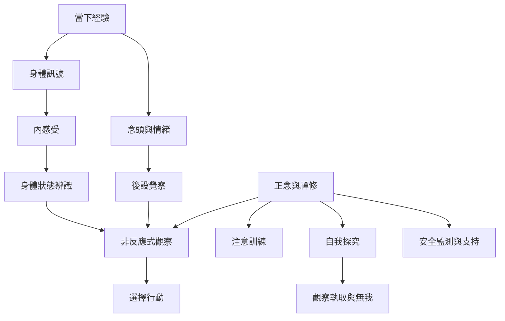

身體訊號、當下覺察與禪修方法，提供了不同於自我敘事的觀察入口。身體覺察不是情緒解碼器；冥想也不是單一技術。這張圖呈現身體內感受與注意訓練如何可能支持覺察，同時保留效果測量與個人安全的界線。

## 概念連結
[[Interoception]]、[[Embodied_self]]、[[Mindfulness]]、[[Meta-awareness]]、[[Anatta]]、[[Self-compassion]]。

## 參考
[[身體內感受為自我狀態提供前語言訊號]]、[[禪修可改變自我歷程但不同方法與風險不能混為一談]]、[[冥想與正念的安全評估必須納入不良經驗與支持條件]]。
