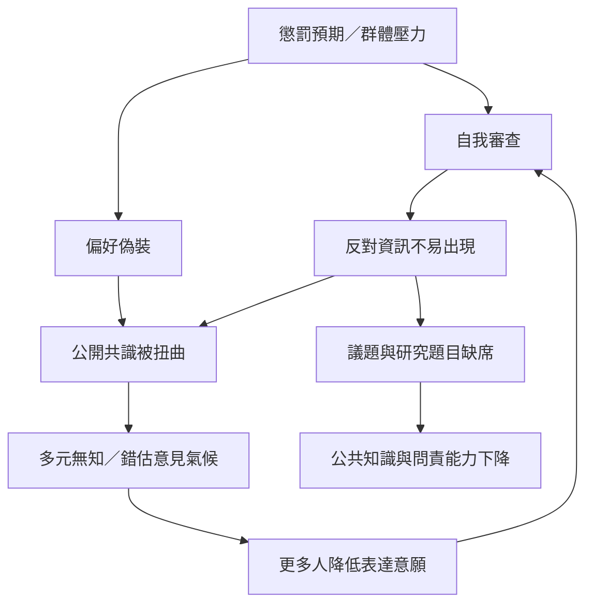

自我審查對公共生活的影響，並不止於減少某些人的發言。當不同人都因相似壓力而沉默，社會可能錯估多數意見、維持錯誤共識，甚至讓某些問題失去被研究與討論的機會。這張地圖將個人決策與公共知識的回饋循環連起來。

沉默螺旋提供意見氣候與表達之間的實證關係；偏好偽裝理論則說明私人偏好與公開立場如何分離。香港新聞、研究者和女性記者案例展示，資訊缺席也會透過消息來源退縮、職涯避險與線上暴力發生。

## 參考與延伸

* [[note/沉默不是同意也不是私人信念的可靠指標]]
* [[note/公開表態可能製造錯誤共識並回頭塑造私人知識]]
* [[note/公共資訊的缺席會使權力更難被檢驗]]
* [[note/自我審查會改變未來可被研究與討論的問題]]
* [[data/沉默螺旋的平均效果存在但會隨談話情境明顯改變]]
* [[data/偏好偽裝會讓公開支持與私人偏好長期分離]]
* [[data/政治爭議可能使研究者刪改用語或放棄研究題目]]
* [[data/女性記者遭受網路暴力會增加社群平台上的自我審查]]
* 概念：[[term/Spiral of silence 沉默螺旋]]、[[term/Pluralistic ignorance 多元無知]]、[[term/Preference falsification 偏好偽裝]]。

專題導讀：[[Self-censorship]]
