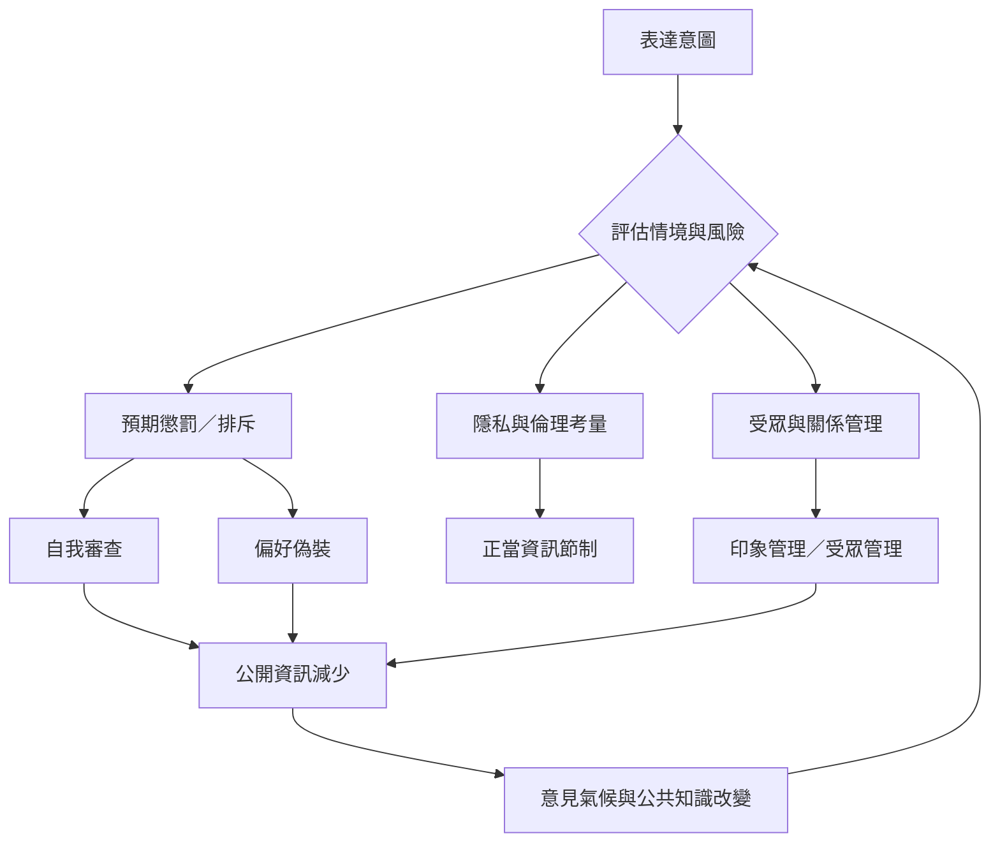

自我審查不是單一心理反應，而是由風險評估、社會認同、預期孤立、印象管理與資訊控制共同構成的決策過程。這張地圖從個人層次整理表達前的心理機制，也區分自主的隱私管理與受到壓力的噤聲。

自我審查的基本定義見[[data/自我審查是在正式禁令之外預先調整資訊表達的行為]]；它與偏好偽裝的差異見[[data/偏好偽裝會讓公開支持與私人偏好長期分離]]。沉默螺旋與多元無知說明個人如何感知群體意見，社群媒體脈絡崩塌則說明受眾結構如何改變揭露策略。

## 參考與延伸

* [[note/自我審查是一種由風險預期塑造的表達選擇]]
* [[note/自我審查必須同時分析沉默的原因與受益者]]
* [[note/隱私界線與恐懼性噤聲需要不同的判準]]
* [[note/沉默不是同意也不是私人信念的可靠指標]]
* [[idea/每次沉默都可以先辨識風險來源再決定是否表達]]
* [[idea/群體討論應同時測量私人意見公開意見與多數想像]]
* 概念：[[term/Self-censorship 自我審查]]、[[term/Preference falsification 偏好偽裝]]、[[term/Spiral of silence 沉默螺旋]]、[[term/Pluralistic ignorance 多元無知]]、[[term/Privacy management 隱私管理]]。

專題導讀：[[Self-censorship]]
