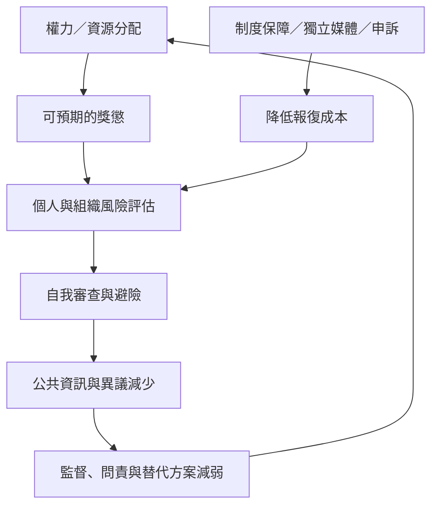

自我審查會出現在新聞、學術、職場、社群平台與日常關係中。各場域的懲罰資源不同：國家可能控制法律與人身安全，企業控制職涯和資源，平台控制觸及與帳號，群體關係則控制歸屬與聲譽。制度依賴會讓外部權力轉化為個人預先管理表達的習慣。

土耳其學界、俄羅斯新聞工作、香港消息來源網絡與日本媒體政治關係呈現不同的制度路徑。全球研究者調查和 UNESCO 的趨勢資料則提醒，民主制度與專業自治也不能完全免於資助、平台與騷擾壓力。

## 參考與延伸

* [[note/自我審查會沿著制度依賴關係擴散]]
* [[note/自我審查的代價不是平均分配的]]
* [[note/同一個人會在不同場域面對不同的感知審查者]]
* [[note/自我審查會改變未來可被研究與討論的問題]]
* [[data/土耳其學者訪談顯示政治威脅會改變研究與學術參與]]
* [[data/俄羅斯記者的自我審查同時受到政治壓力與個人規範影響]]
* [[data/香港新聞自我審查會經由消息來源退縮擴散到整個資訊生態]]
* [[data/日本新聞媒體與政治的制度性互賴可能形成自我審查氣候]]
* [[data/多國研究者調查顯示發表研究也會受到職涯風險影響]]
* 概念：[[term/Risk culture 風險文化]]、[[term/Academic freedom 學術自由]]、[[term/Freedom of expression 言論自由]]。

專題導讀：[[Self-censorship]]
