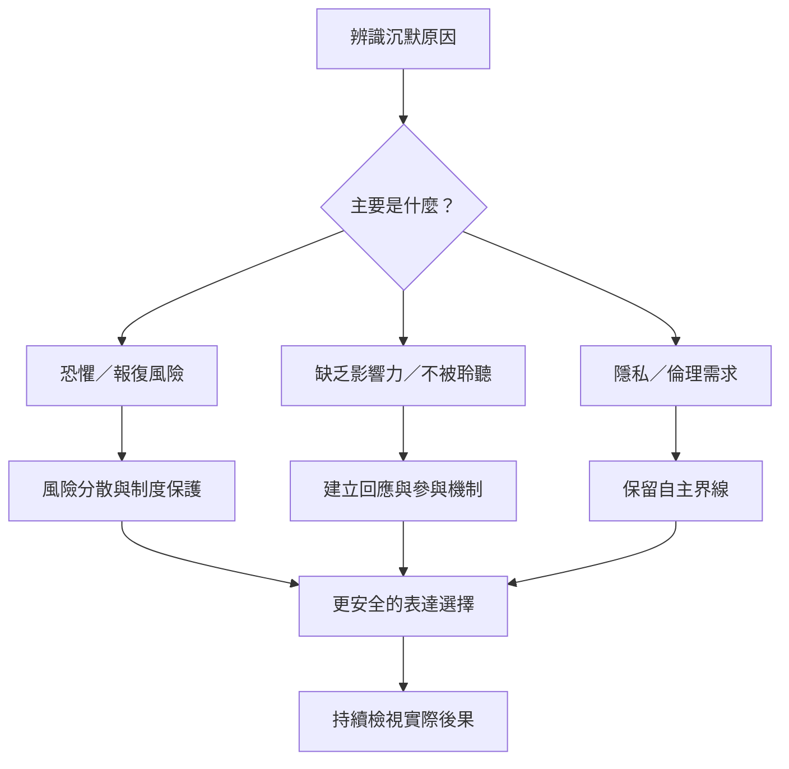

降低有害的自我審查，不等於要求所有人完全公開。可行方向是提高表達選擇的自主性：個人能辨認風險、控制受眾、選擇表達方式；群體能讓異議不受羞辱；制度能提供反報復、隱私、獨立審查與申訴保障。這張地圖把個人實踐與結構性改善放在同一框架。

反自我審查的核心不是追求最大聲量，而是讓個人不必因不正當懲罰而放棄重要表達，同時保留不揭露私人資訊的權利。可由日常風險紀錄、匿名意見蒐集與制度性回應規則開始。

## 參考與延伸

* [[note/隱私界線與恐懼性噤聲需要不同的判準]]
* [[note/數位表達應兼顧可見性自主與公共參與]]
* [[note/保護表達自由比要求個人勇敢更能降低自我審查]]
* [[idea/每次沉默都可以先辨識風險來源再決定是否表達]]
* [[idea/社群可以透過低風險發言設計減少沉默螺旋]]
* [[idea/組織應建立未被提出問題的紀錄而不只保存決策結果]]
* [[idea/數位社群應讓成員自主控制受眾而非鼓勵全面曝光]]
* [[idea/研究者可以追蹤敏感題目如何在研究流程中消失]]
* [[idea/建立表達安全指標時應同時測量權利成本與實際回應]]

專題導讀：[[Self-censorship]]
