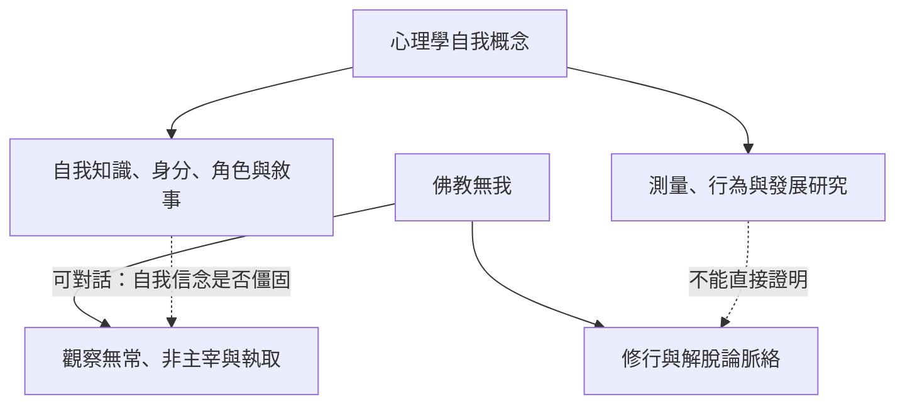

心理學研究自我表徵如何形成、組織與影響行動；佛教無我則在解脫論脈絡中探討對身心現象的執取。兩者能在「自我信念如何變得僵固」的問題上相互啟發，但使用的概念、方法與目標不同。

閱讀 [[佛教無我是在鬆動執取而非否認日常經驗中的人格功能]]，並對照 [[自我概念清晰度不是自我信念正確性的保證]]、[[自我慈悲讓承認痛苦不必固化羞恥]]。概念見 [[Anatta]]、[[term/Self-concept]]、[[Self-compassion]]。
