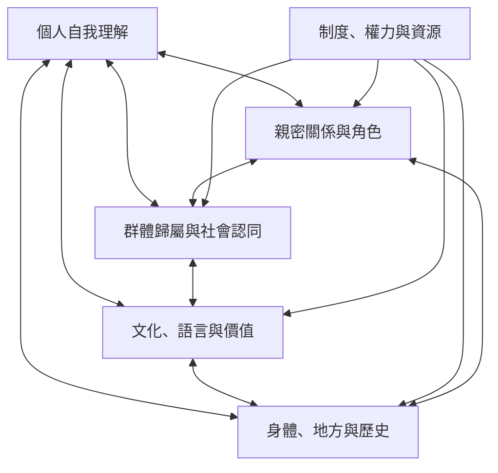

個人特質不是自我概念的全部。關係、角色、群體、地方與文化提供自我描述的語言、行動機會和價值脈絡。跨文化比較需要多維度測量，也要尊重每個群體內部的差異與自身知識。

核心閱讀：[[自我不是只有個人層次也包含關係角色與群體歸屬]]、[[文化差異需要多維度描述而不是國籍標籤]]、[[關係與地方都是自我模型的一部分]]。案例包括 [[Māori 青年的人際連結與互惠關係可支持福祉]]、[[澳洲原住民族社會情緒福祉連結身體家族社群文化土地與靈性]] 與 [[Ubuntu 將人格理解為在關係中成為人]]。概念參照 [[Self-construal]]、[[Social identity]]、[[Whanaungatanga]]、[[Ubuntu]]。

全書脈絡見 [[Self-concept.md]]。
