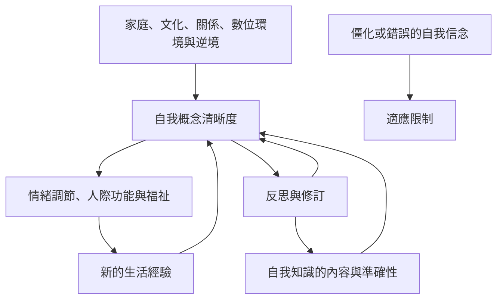

清晰的自我信念可能支持方向感與情緒調節，但清晰不代表準確，更不表示僵化。自我概念會受到家庭、關係、文化、生活事件與數位環境影響；清晰度與適應之間的因果方向仍需要縱貫與實驗研究。

閱讀 [[自我概念清晰度描述自我信念的清楚一致與時間穩定]]、[[自我概念清晰度研究需要跨方法跨文化與因果設計]]、[[穩定的自我模型仍需要保留修訂空間]]。再以 [[自我概念清晰度不是自我信念正確性的保證]] 校正「越清楚越好」的直覺。概念見 [[Self-concept clarity]]、[[Self-knowledge]]。

全書脈絡見 [[Self-concept.md]]。
