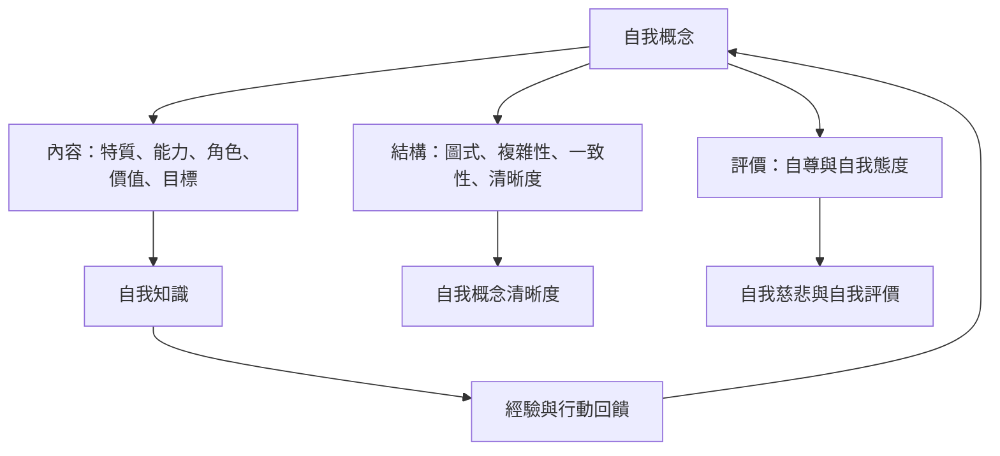

自我概念的研究可以先問三個不同問題：我如何描述自己（內容）？這些信念如何組織（結構）？我如何評價自己（價值評估）？自我概念清晰度則關注結構的清楚、一致與穩定，不等於內容正確。

建議把 [[自我概念是由特質角色價值與目標組成的組織化知識]] 作為入口，再閱讀 [[自我概念與自尊分別回答我是誰與我是否有價值]]、[[自我概念清晰度不是自我信念正確性的保證]]，並參照 [[term/Self-concept]]、[[Self-schema]]、[[Self-esteem]] 與 [[Self-concept clarity]]。
