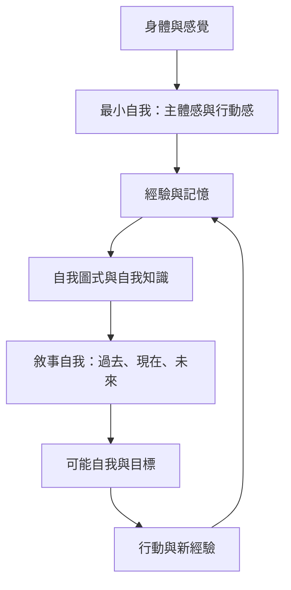

自我經驗不是單一層次。身體主體感提供當下的經驗基礎；自我圖式組織與自身相關的經驗；敘事認同則把記憶與想像編排成跨時間的生命故事。三者相互作用，但不能彼此取代。

從 [[身體經驗提供自我感的前反思基礎]] 開始，接續 [[最小自我與敘事自我回答不同層次的自我問題]]、[[敘事自我透過故事提供連續感但不等於固定本質]]、[[可能自我是行動假設而不是命運預言]]。概念參照 [[Minimal self]]、[[Narrative identity]]、[[Possible selves]]。

全書脈絡見 [[Self-concept.md]]。
