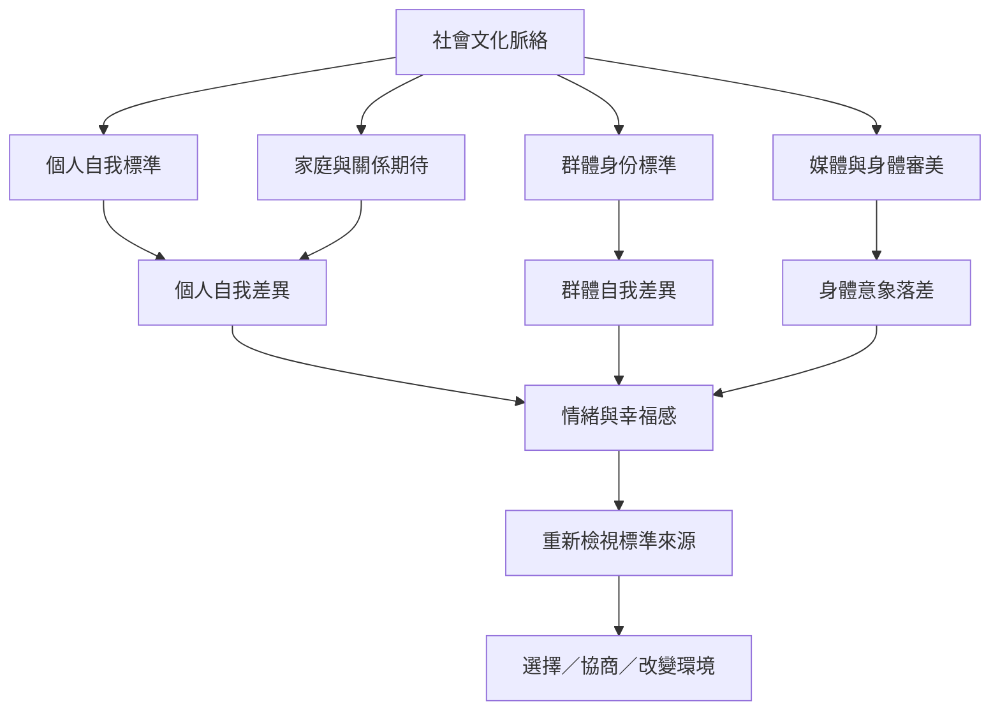

自我差異不只發生在個人內在，也會受到家庭、群體、國家、身體意象與社會媒體的標準影響。文化與制度決定哪些理想容易被看見、哪些責任被視為理所當然，以及誰有權定義群體的理想。

區域研究包括[[韓國研究顯示文化取向會改變個人理想與應然落差的幸福關聯]]、[[以色列研究將自我差異理論延伸到群體認同]]與[[日本身體意象研究區分知覺落差與理想落差]]。實作構想見[[以三乘二自我地圖辨認標準來源而不是急著修正自己]]、[[先問自我標準是誰的再決定是否追趕落差]]與[[將群體理想變成可共同修訂的公共討論]]。
