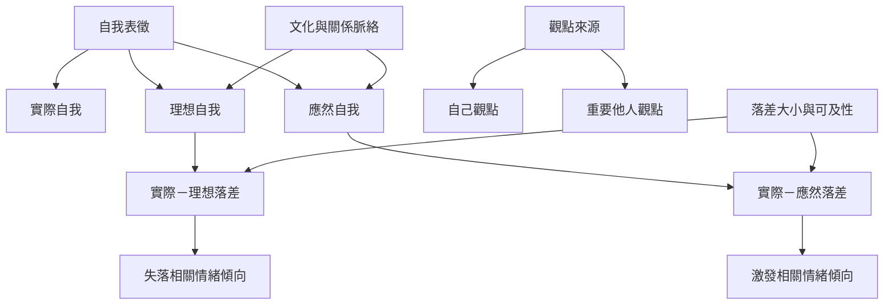

自我差異理論以實際自我、理想自我、應然自我為主要自我領域，並區分自己與重要他人的觀點。不同表徵之間的落差，可能因大小與心理可及性而與不同情緒經驗相關。這張概念圖呈現理論骨架，不將理論關聯等同診斷或因果。

理論主張見[[自我差異理論將自我表徵落差連結到不同情緒脆弱性]]；定義見[[自我差異（Self-discrepancy）]]、[[實際自我（Actual self）]]、[[理想自我（Ideal self）]]與[[應然自我（Ought self）]]。
