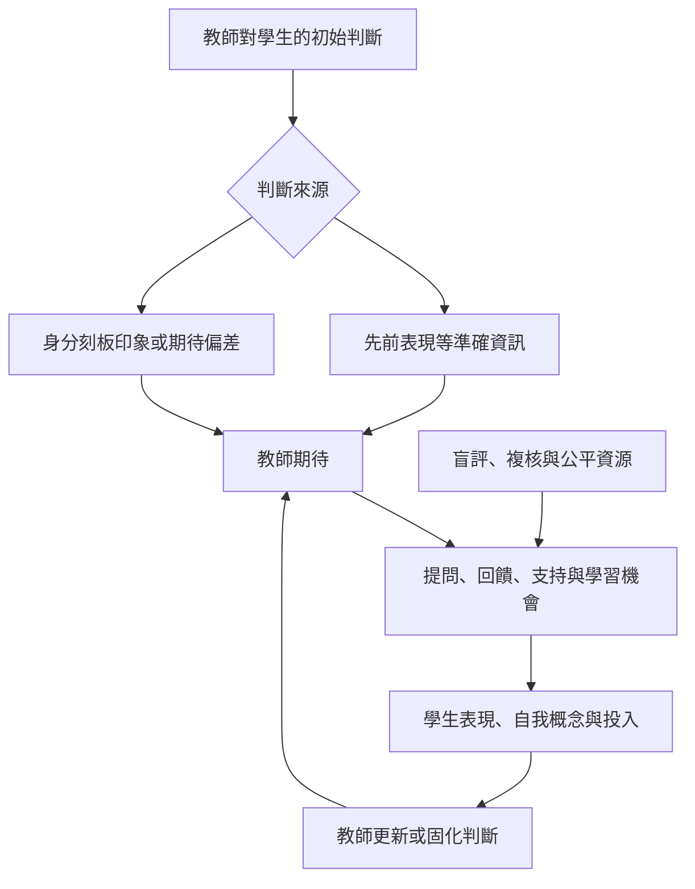

教育與評量是觀察期待如何轉化為差別待遇的主要場域。教師期待可能提升支持與機會，也可能因低估、刻板印象或制度分類而壓縮學生發展空間；同時，教師期待也可能只是對學生先前表現的準確判斷。

* 核心概念：[[教師期待效應]]、[[Pygmalion 效應]]、[[Golem 效應]]、[[刻板印象威脅]]、[[期待偏差]]。
* 分析論點：[[教師期待效應是真實但通常有限且受學生身分與情境調節]]、[[刻板印象威脅是情境壓力而非群體能力的證明]]、[[制度化分類會把偏見轉成不平等的資源與機會]]。
* 地域資料：[[Gentrup_等_2020_德國一年級教師期待的錯誤部分仍能預測學年成績]]、[[Hao_等_2022_中國高中教師期待偏差會隨時間與學科動態變化]]、[[Bihar_印度_2026_種姓身分會影響教師對學生學業能力的評價]]。
