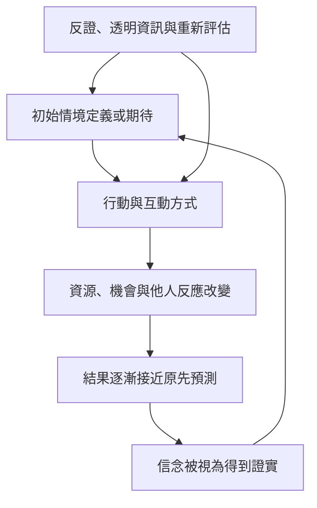

自我實現預言可理解為一個從情境定義到行動、再到回饋確認的循環。它與 Thomas 定理相連，但比 Thomas 定理更聚焦於原先錯誤的預期如何創造自身成立的條件。

* 核心概念：[[自我實現預言]]、[[Thomas 定理]]、[[行為確認]]、[[確認偏誤]]。
* 深入論點：[[自我實現預言必須經過行動回饋才會成為因果機制]]、[[準確期待與自我實現期待必須在因果分析中分開]]。
* 研究來源：[[Merton_1948_自我實現預言把錯誤情境定義轉化為真實後果]]、[[Snyder_與_Swann_1978_互動者會以提問方式誘發對方確認既有印象]]。
