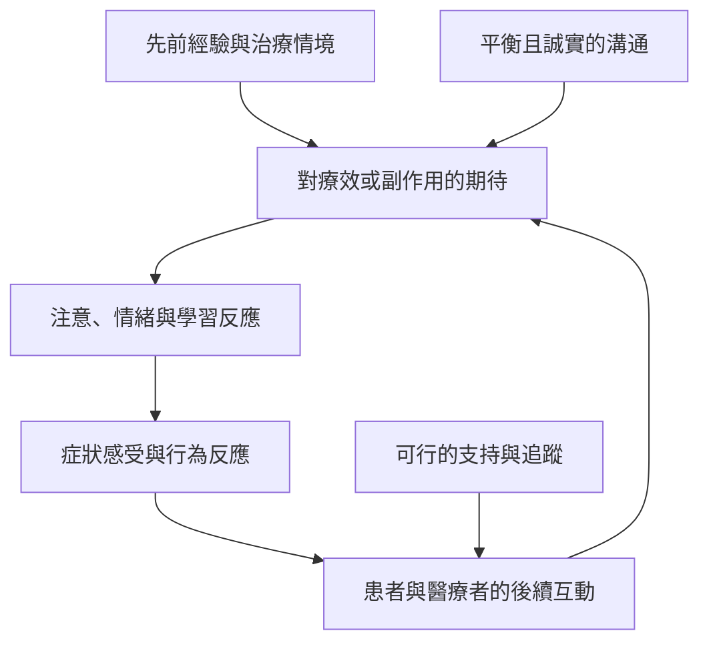

在醫療情境中，期待可透過學習、注意、焦慮、社會觀察與治療溝通影響症狀經驗。這些作用不能被用來否認生理病因，而應成為改善知情同意與照護品質的一部分。

* 核心概念：[[Placebo 效應]]、[[Nocebo 效應]]、[[自我實現預言]]。
* 論點：[[醫療期待會改變症狀經驗但不代表症狀不真實]]。
* 研究與訪談：[[Colloca_等_2020至2025_醫療期待與_nocebo_效應會改變症狀經驗]]、[[研究者訪談揭示期待效應必須同時考慮情境威脅與倫理溝通]]。
