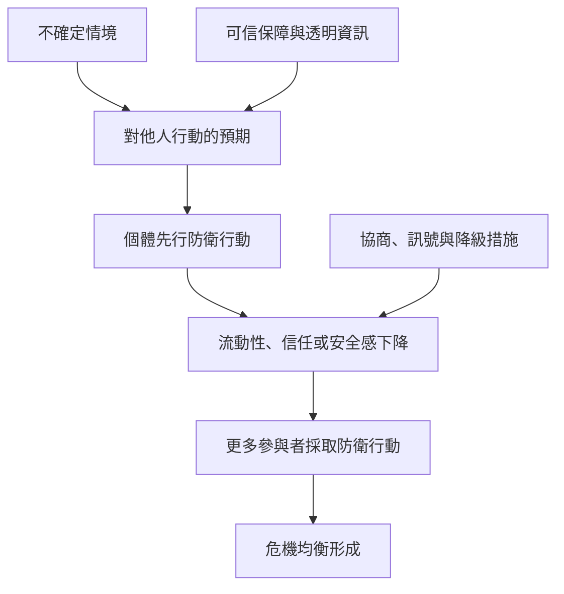

集體預期可能在金融與政治系統中形成自我強化回饋。個體行動看似理性，但當每個人都預期其他人會採取防衛行動時，結果可能是所有人共同造成原先想避免的危機。

* 核心概念：[[多重均衡]]、[[自我挫敗預言]]、[[自我實現預言]]。
* 論點：[[集體預期能在多重均衡中選出危機路徑]]、[[預言也可能因為促成防範行動而自我挫敗]]。
* 案例：[[Diamond_Dybvig_與_Obstfeld_指出銀行擠兌與貨幣危機可能由集體預期觸發]]、[[Houghton_2009_國際關係中的預言可能自我實現也可能自我挫敗]]。
