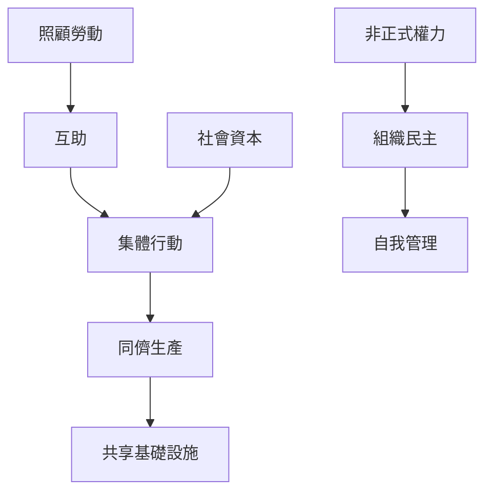

本圖對照互助網絡、集體認同、合作社民主、同儕生產與非正式權力。自發協作要能持續，需要的不只是善意，還包括可見的角色、資源、責任與問責。

## 關係圖

## 核心詞條
[[集體行動]]、[[社會資本]]、[[同儕生產]]、[[互助]]、[[自我管理]]、[[自治]]、[[社會再生產]]、[[組織民主]]、[[非正式權力]]、[[照顧勞動]]。

## 相關筆記
* [[疫情互助行動既回應物質需求也形成集體認同]]
* [[蒙德拉貢合作社的民主參與能連結工作認同]]
* [[合作社國際化可能削弱工作者的參與權]]
* [[同儕生產讓非市場動機也能支撐大規模協作]]
* [[無中心協作仍需要可被追蹤的參與規則]]
* [[互助網絡的韌性在危機前就開始累積]]
* [[自治不能把隱形維護勞動當成免費資源]]
* [[組織民主必須檢查誰真正能影響決策]]

## 其他概念地圖
[[自我組織的系統科學與複雜性]]、[[生命系統的自我生成與環境互賴]]、[[共同資源與多中心自治制度]]、[[災害、城市與地方韌性]]、[[數位知識共作與間接協調]]。
