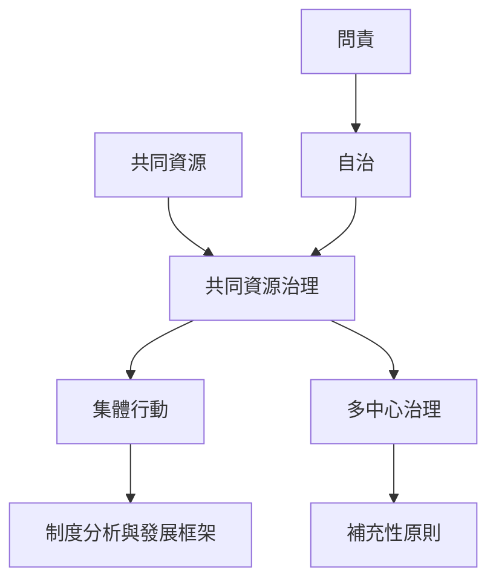

這張地圖從共同資源使用者出發，連結規則制定、監測、爭端處理、跨尺度權限與多中心治理。重點不是複製制度配方，而是讓使用者有能力持續修訂規則。

## 關係圖

## 核心詞條
[[共同資源]]、[[共同資源治理]]、[[多中心治理]]、[[集體行動]]、[[自治]]、[[制度分析與發展框架]]、[[補充性原則]]。

## 相關筆記
* [[共同資源可以由使用者形成持久的自治制度]]
* [[制度原則應從長期案例歸納而非當成普遍命令]]
* [[多中心治理讓多個決策中心在不同尺度協作]]
* [[印度灌溉用水者協會展現地方水資源自治的條件]]
* [[肯亞社區供水顯示地方自治的勞動成本具有性別差異]]
* [[共同資源治理需要由使用者參與制定規則]]
* [[自治制度需要監測與可修訂的規則]]
* [[多中心治理能在尺度之間分配協調工作]]

## 其他概念地圖
[[自我組織的系統科學與複雜性]]、[[生命系統的自我生成與環境互賴]]、[[互助、社會運動與合作組織]]、[[災害、城市與地方韌性]]、[[數位知識共作與間接協調]]。
