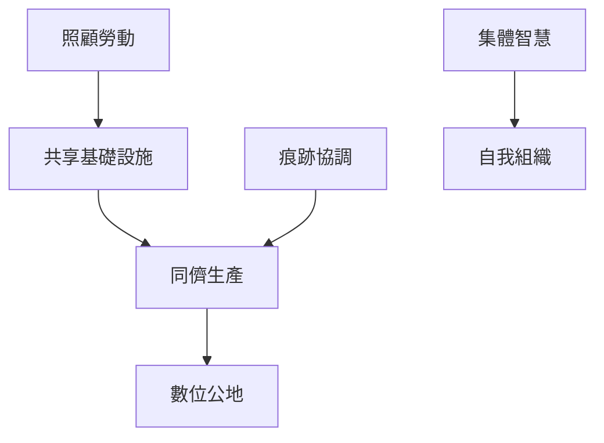

數位知識庫、自由軟體與同儕生產仰賴可共享的基礎設施、模組化任務與可追蹤的行動痕跡。開放參與也需要品質管理、照顧與維護。

## 關係圖

## 核心詞條
[[自我組織]]、[[痕跡協調]]、[[同儕生產]]、[[照顧勞動]]、[[共享基礎設施]]。

## 相關筆記
* [[同儕生產讓非市場動機也能支撐大規模協作]]
* [[同儕生產與數位公共領域需要共享基礎設施]]
* [[間接留下的行動痕跡可以協調複雜協作]]
* [[同儕生產依靠模組化任務與多元動機]]
* [[痕跡協調能降低直接溝通的需求]]
* [[自治不能把隱形維護勞動當成免費資源]]

## 其他概念地圖
[[自我組織的系統科學與複雜性]]、[[生命系統的自我生成與環境互賴]]、[[共同資源與多中心自治制度]]、[[互助、社會運動與合作組織]]、[[災害、城市與地方韌性]]。
