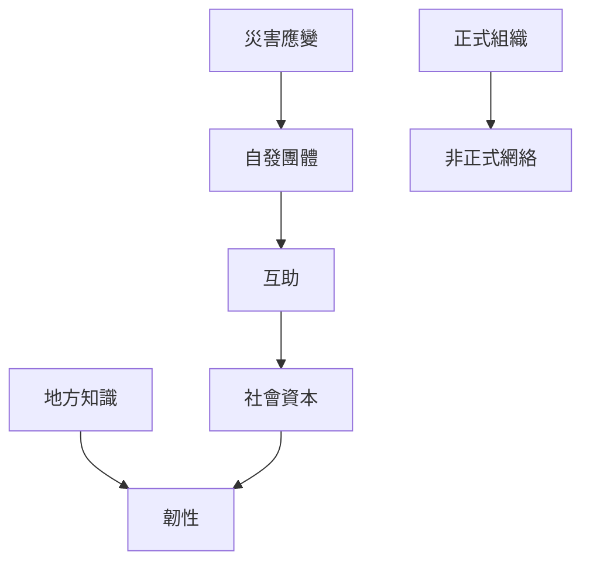

從災害應變、災後社區形成、城市規劃到台灣莫拉克案例，分析地方行動如何與正式制度互補，以及地方自治為何需要信任、資源與代表性。

## 關係圖

## 核心詞條
[[湧現]]、[[社會資本]]、[[互助]]、[[韌性]]。

## 相關筆記
* [[災難中的自發團體是城市應變能力的重要部分]]
* [[災害應變同時依賴正式組織與非正式社會網絡]]
* [[莫拉克風災後草根組織能否持續取決於在地信任]]
* [[災後社區形成依賴正式組織與非正式關係的多層累積]]
* [[聖保羅非正式聚落的自治是多節點的政治協商過程]]
* [[非正式聚落治理需要承認多方利益與地方協調]]
* [[地方知識應能進入正式規劃]]

## 其他概念地圖
[[自我組織的系統科學與複雜性]]、[[生命系統的自我生成與環境互賴]]、[[共同資源與多中心自治制度]]、[[互助、社會運動與合作組織]]、[[數位知識共作與間接協調]]。
