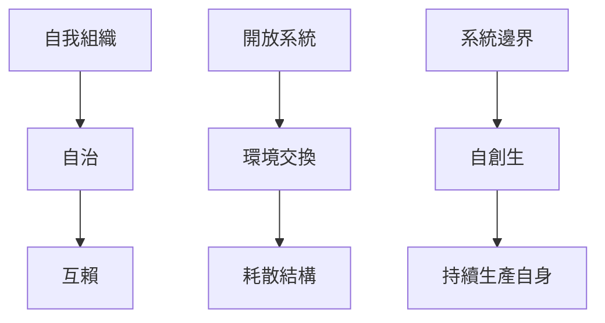

從自創生與耗散結構理解生命系統的組織、邊界與環境交換，並提醒不能把生命理論不加區分地移植到社會治理。

## 關係圖

## 核心詞條
[[自我組織]]、[[耗散結構]]、[[自創生]]、[[開放系統]]。

## 相關筆記
* [[自創生理論把生命理解為持續生產自身的網絡]]
* [[耗散結構顯示遠離平衡的開放系統也能形成秩序]]
* [[自創生描述系統如何持續生產自身]]
* [[自我組織需要與環境持續交換]]
* [[跨領域類比必須保留機制差異]]

## 其他概念地圖
[[自我組織的系統科學與複雜性]]、[[共同資源與多中心自治制度]]、[[互助、社會運動與合作組織]]、[[災害、城市與地方韌性]]、[[數位知識共作與間接協調]]。
