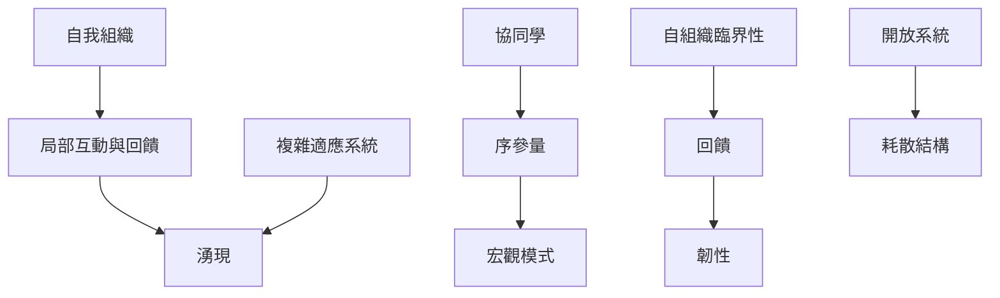

本圖整理自我組織在系統科學中的核心問題：局部互動如何透過回饋形成宏觀模式，開放系統如何維持動態秩序，以及跨領域類比何時有效、何時需要止步。

## 關係圖

## 核心詞條
[[自我組織]]、[[湧現]]、[[複雜適應系統]]、[[回饋]]、[[耗散結構]]、[[協同學]]、[[序參量]]、[[自組織臨界性]]、[[韌性]]。

## 相關筆記
* [[自我組織是一個跨學科問題而非單一學說]]
* [[協同學說明微觀互動如何形成宏觀有序模式]]
* [[耗散結構顯示遠離平衡的開放系統也能形成秩序]]
* [[自組織臨界性描述系統如何自發走向臨界狀態]]
* [[跨領域類比必須保留機制差異]]
* [[局部互動可以生成整體秩序]]
* [[回饋迴路讓集體行動能自我修正]]
* [[局部變化可能透過回饋造成跨尺度效應]]

## 其他概念地圖
[[生命系統的自我生成與環境互賴]]、[[共同資源與多中心自治制度]]、[[互助、社會運動與合作組織]]、[[災害、城市與地方韌性]]、[[數位知識共作與間接協調]]。
