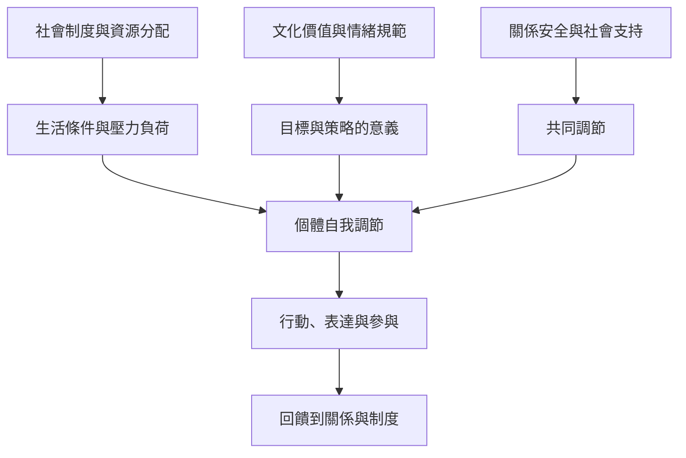

個體調節能力不是在真空中形成。關係可以提供共同調節，文化會塑造情緒表達與行動目標，制度則決定時間、資源、權力與可選擇的空間。這張地圖將三個脈絡放在一起，避免把所有困難都變成個人責任。

本圖連結[[自我調節的目標由文化價值與關係規範共同形塑]]、[[自我調節常由人際支持共同完成]]及[[自我調節不能把制度造成的困境全部歸責個人]]。文化差異應依研究證據和脈絡解釋，不能用來合理化壓迫。

本圖亦可延伸至[[關係性知識提醒自我調節不只發生在孤立個體之內]]，對照澳洲原住民族、毛利青年與非洲哲學如何從關係網絡理解福祉與人格。

## 思與行
- 分析一個調節困難時，分別記錄個人、關係、文化與制度因素。
- 在可行範圍內同時設計個人策略與集體改善措施。

## 參考
- [[自我調節的目標由文化價值與關係規範共同形塑]]
- [[自我調節常由人際支持共同完成]]
- [[自我調節不能把制度造成的困境全部歸責個人]]

---

[[Self-regulation|回到全書導讀]]

