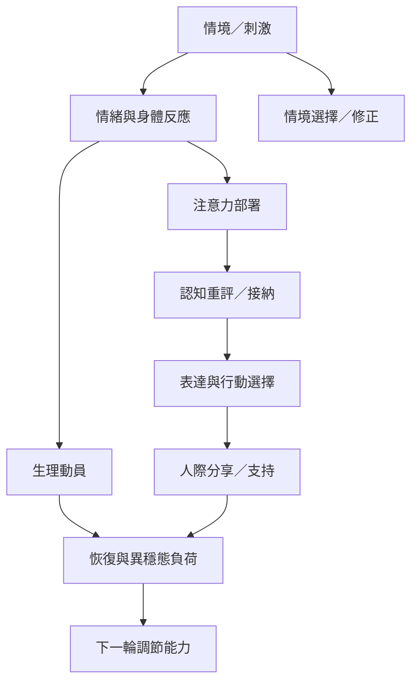

情緒與身體調節包含不同介入點：可在事件前調整情境，也可在事件中調整注意與意義，或在反應後調整表達、尋求支持及恢復。異穩態視角提醒，身體需要動員也需要恢復；正念與心理彈性則讓調節不必等同壓抑。

重要區分是[[情緒調節不等於壓抑情緒]]；策略應參考[[調節策略應依情境與介入時機選擇]]，並連結[[正念調節的核心是清楚監測並減少自動反應]]及[[身體調節能力仰賴動員與恢復之間的節律]]。

## 思與行
- 為同一種困擾測試不同介入點，觀察何者提升選擇能力而非只壓低表面反應。
- 將恢復時間納入調節評估，避免只看情緒當下是否下降。

## 參考
- [[情緒調節不等於壓抑情緒]]
- [[調節策略應依情境與介入時機選擇]]
- [[正念調節的核心是清楚監測並減少自動反應]]
- [[身體調節能力仰賴動員與恢復之間的節律]]

---

[[Self-regulation|回到全書導讀]]

