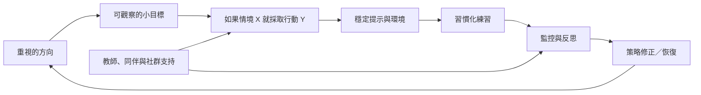

自我調節可以透過學習循環、執行意圖與習慣設計落實在日常生活；但有效實踐不等於把每一刻都變成績效追蹤。重點是建立可回顧、能修正、具自主性且不排除休息的行動系統。

這張圖結合[[學習能力會在規劃、監控與反思的循環中形成]]、[[具體的情境連結能讓意圖更容易轉化成行動]]與[[先改造環境再要求自己抵抗誘惑]]。它同時受[[自我調節可能同時是自我照顧與自我規訓]]提醒：工具和指標必須服務生活。

## 思與行
- 每次只建立一項可持續的微型練習，保留回顧和停止的權利。
- 將同伴支持、共同學習與環境調整納入計畫，而非只追蹤個人完成率。

## 參考
- [[學習能力會在規劃、監控與反思的循環中形成]]
- [[具體的情境連結能讓意圖更容易轉化成行動]]
- [[先改造環境再要求自己抵抗誘惑]]
- [[自我調節可能同時是自我照顧與自我規訓]]

---

[[Self-regulation|回到全書導讀]]

