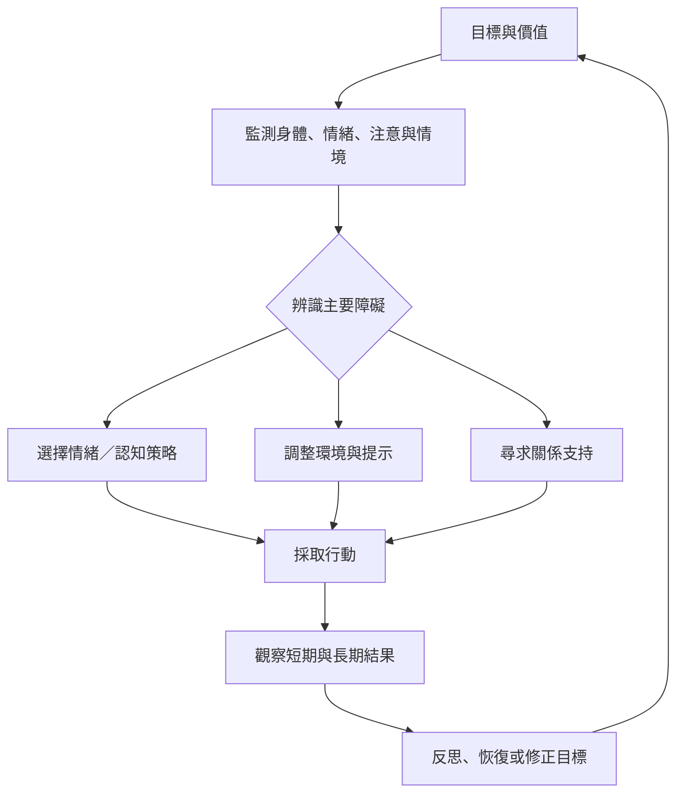

自我調節可以視為從目標到行動、再由結果回到目標的回饋循環。此圖把內在監測、策略選擇、行動執行與結果評估串起來，並提醒身體狀態、環境與關係會影響每一階段。

這個模型連結[[整合研究指出自我調節是多層次且彼此交織的心理歷程]]、[[環境設計能降低每次行動所需的自我控制成本]]與[[自我調節常由人際支持共同完成]]。它不是線性流程；人可能從任何階段開始，也可能需要先休息或改變外部條件。

## 思與行
- 以此圖分析一個真實情境，標記哪個環節最缺資源。
- 若行動未發生，不急著歸因意志薄弱，檢查目標、策略、環境、支持與恢復是否匹配。

## 參考
- [[自我調節是一種跨層次的回饋協調，而非單一意志力]]
- [[環境設計能降低每次行動所需的自我控制成本]]
- [[自我調節常由人際支持共同完成]]

---

[[Self-regulation|回到全書導讀]]

