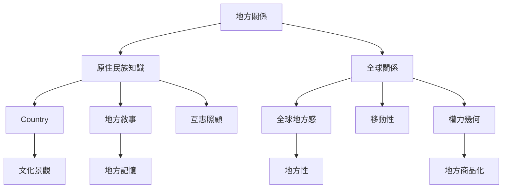

地方感的跨文化比較必須尊重不同知識傳統。原住民族地方關係可能涉及 Country、祖先、文化責任、土地與水域、非人類生命以及代際知識；全球地方感則指出，地方也由跨地域關係和不平等流動共同形成。兩者不宜被當成同一套理論的不同案例，而應在尊重各自脈絡下進行對話。

核心概念：[[Country]]、[[互惠照顧]]、[[全球地方感]]、[[移動性]]、[[權力幾何]]、[[文化景觀]]與[[地方性]]。

## 延伸閱讀
* [[原住民族地方連結植根於文化關係安全與共同參與]]
* [[阿帕契地名與故事把景觀轉化為倫理記憶]]
* [[拉丁美洲地方感研究連結流動領土與恐懼]]
* [[在地知識需要和全球關係一起理解]]
