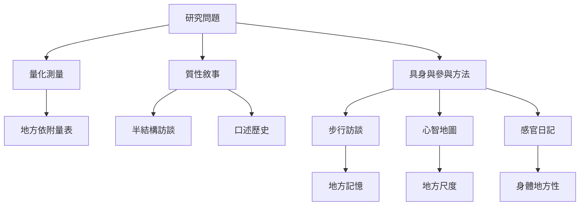

地方感研究需要讓方法與問題相配。問卷量表有利於比較地方依附構面；訪談和口述史可追索地方意義；步行訪談、感官日記和心智地圖則讓日常路徑與身體經驗進入資料。參與式研究還需要處理同意、知識權利和資料回饋。

核心概念：[[步行訪談]]、[[心智地圖]]、[[地方尺度]]、[[身體地方性]]、[[地方敘事]]與[[地方記憶]]。

## 延伸閱讀
* [[步行訪談與心智地圖能揭露地方依附的多重層次]]
* [[地方依附可區分地方認同與地方依賴]]
* [[地方感的測量必須說明概念與尺度]]
* [[用步行訪談把日常路徑轉化為地方感地圖]]
* [[以一週感官練習辨識身體如何認識熟悉地方]]
