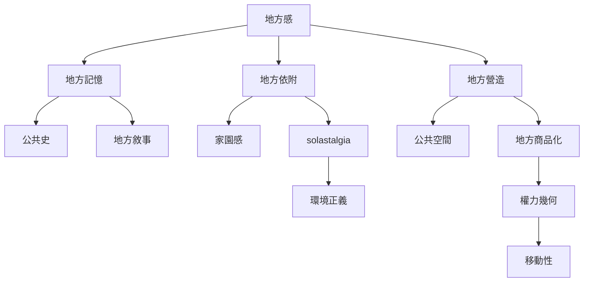

地方感同時涉及歸屬和排除、記憶和遺忘、照顧和支配。地方的誰能代表、誰能使用、誰能改變，以及誰承受環境變遷的代價，都是地方政治的一部分。地方依附可以促成照顧，但也可能與土地商品化、排他地方主義或既有權力結構交織。

核心概念：[[地方記憶]]、[[地方敘事]]、[[公共史]]、[[地方營造]]、[[地方商品化]]、[[solastalgia]]、[[權力幾何]]與[[公共空間]]。

## 延伸閱讀
* [[城市公共史能讓被忽略的社群重新出現在地景]]
* [[氣候與開發造成的環境改變會引發原地失所之苦]]
* [[地方依附可能支持環境照顧卻不保證形成集體行動]]
* [[記錄環境變遷中的不適而不把地方浪漫化]]
