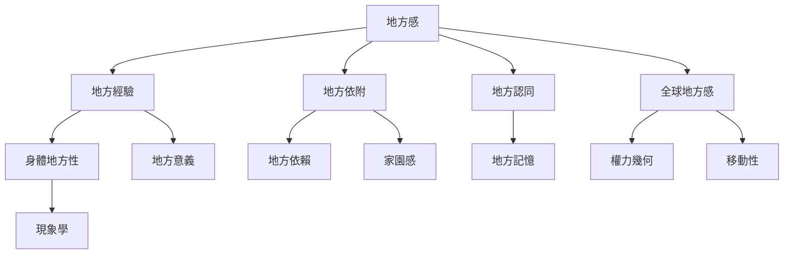

地方感研究可以從經驗、依附、認同、關係性地方與現象學等不同理論路徑切入。人文地理學關心空間如何成為有意義的地方；環境心理學分析地方依附、地方認同和地方依賴；關係性地理學則將地方視為社會互動與全球流動交會的過程。

核心概念請參考[[地方感]]、[[地方]]、[[地方依附]]、[[地方認同]]、[[地方依賴]]、[[全球地方感]]、[[地方意義]]、[[身體地方性]]與[[地方尺度]]。

## 延伸閱讀
* [[人文地理學以生活經驗說明空間如何成為有意義的地方]]
* [[地方依附可由人地方與心理歷程三面向理解]]
* [[地方是社會關係的交會過程而非封閉容器]]
* [[地方感是人與地方共同生成的關係而非地方的固定屬性]]
