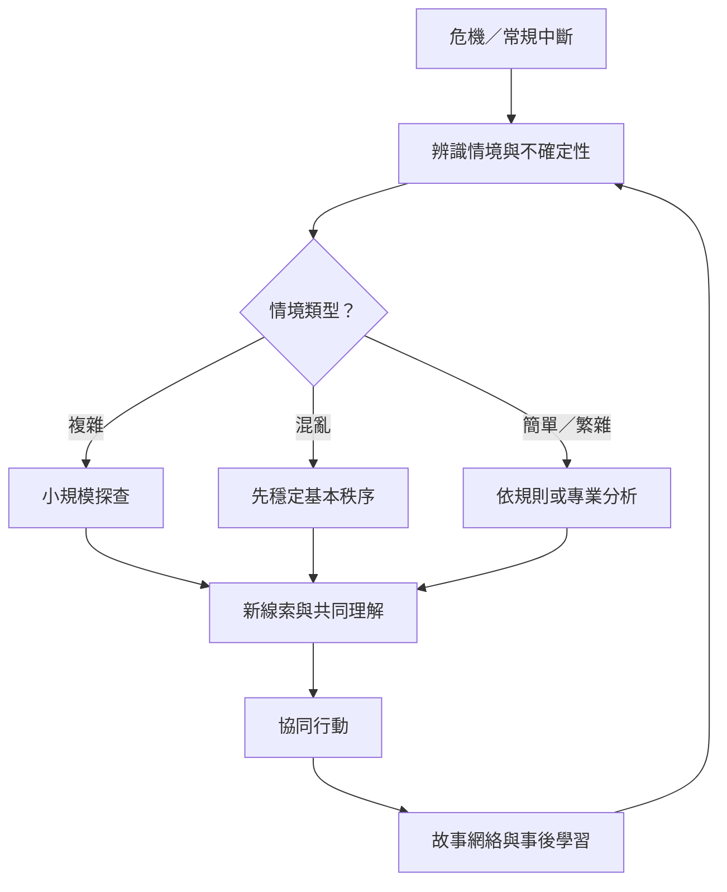

本圖呈現危機中的共享理解、故事網絡和制度學習。危機會打斷常規；社群藉由角色協調、資訊流通與敘事回顧建立可行秩序。不同情境需要不同策略，複雜問題尤其需要可逆的試探。

核心筆記：[[危機時共享身份與語言是協同行動的基礎]]、[[地方故事網絡讓個人經驗進入集體復原]]、[[集體記憶會在新事件中被重新編排]]、[[複雜情境中的理解來自安全探查與模式辨識]]。

概念：[[Cynefin]]、[[Collective_memory]]、[[Narrative]]。

文獻：[[《組織中的意義建構崩解》以 Mann Gulch 火災呈現共享理解瓦解的風險]]、[[《福島鄰里故事網絡》指出地方敘事關係有助於災後心理社會復原]]、[[《台灣客庄的災害韌性》以 921 地震幸存者訪談呈現社會支持的重要性]]、[[《921 地震十週年媒體敘事》顯示災難記憶會成為解釋新事件的框架]]。
