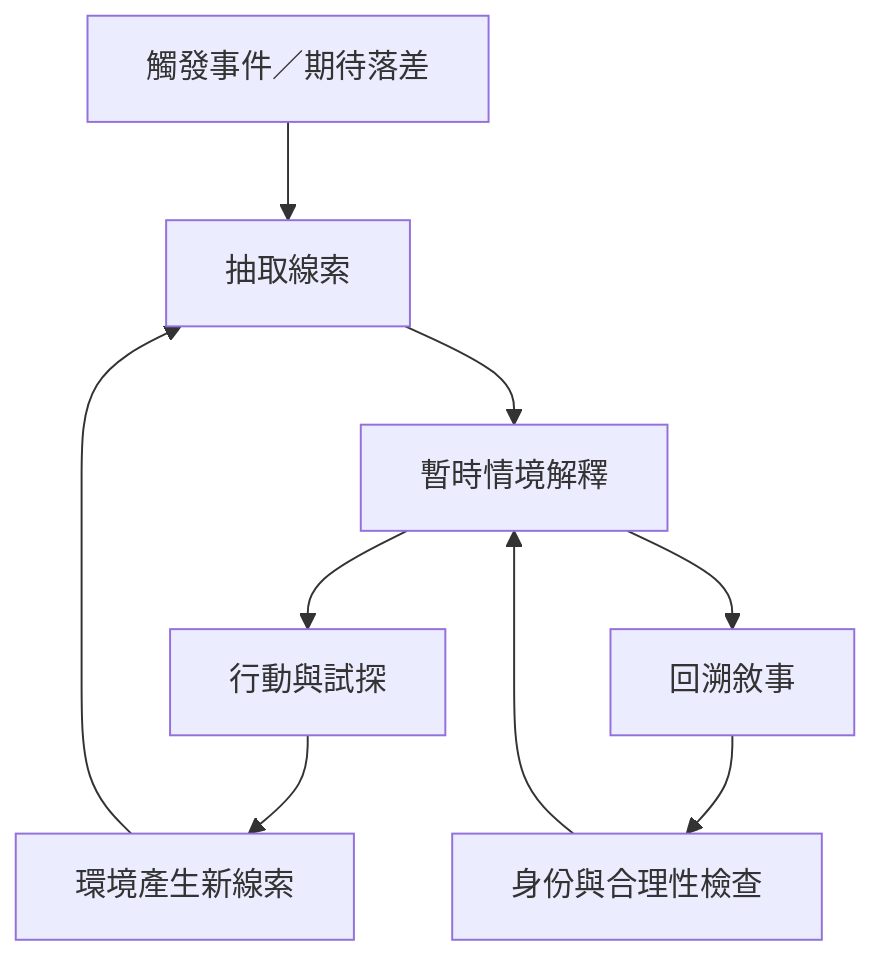

本圖聚焦個體如何從期待落差開始，抽取線索、形成情境解釋、採取行動，再依新線索修正理解。回溯、身份與合理性共同影響每一輪循環。

核心筆記：[[意義建構是持續生成而非一次完成的解釋]]、[[觸發事件讓原本理所當然的理解變得可疑]]、[[身份決定哪些線索會顯得重要]]、[[回溯敘事把零散經驗組織成可理解事件]]、[[行動會改變人們之後能看見的線索]]、[[合理性常比絕對正確更能解釋即時理解]]。

概念：[[Sensemaking]]、[[Enactment]]、[[Retrospection]]、[[Plausibility]]、[[Equivocality]]。

文獻：[[《組織中的意義建構》建立了回溯理解與行動生成的經典框架]]、[[《組織化與意義建構過程》說明理解與組織秩序彼此生成]]、[[《不同視角下的意義建構》提醒意義建構不只是把線索連起來]]。
