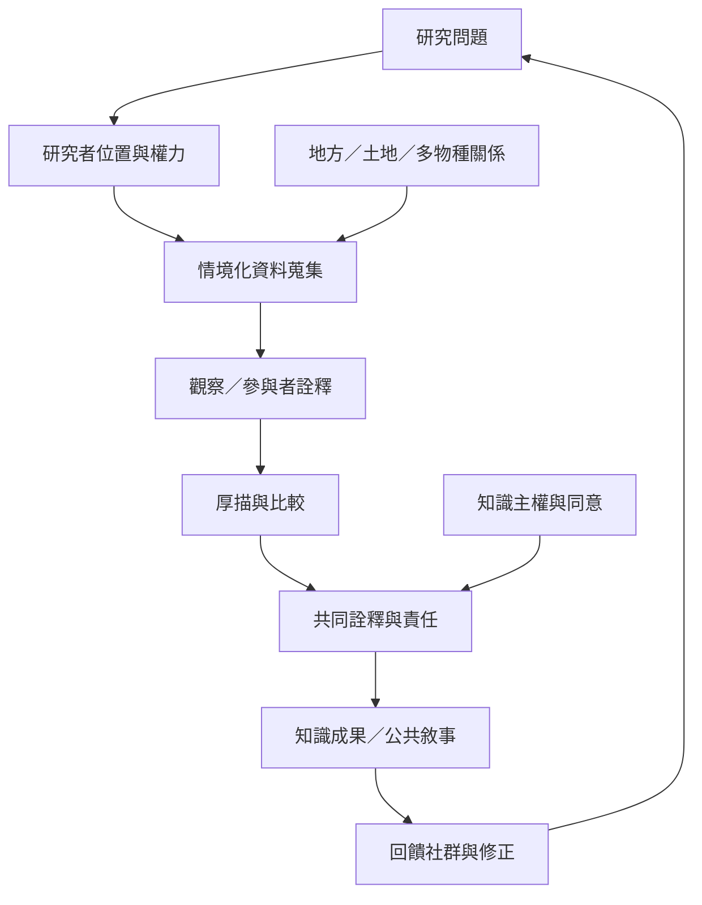

本圖把意義建構放在情境知識、厚描、生活世界與知識權力的脈絡中。研究不只蒐集資料，也介入哪些經驗被命名、引用和公開；跨文化工作需保存差異並對關係負責。

核心筆記：[[知識可能是關係實踐而非個體對外界的表徵]]、[[研究者必須承認不同知識傳統的不可化約性]]、[[跨文化研究需要區分觀察、參與者詮釋與研究者推論]]、[[研究者必須對知識關係承擔持續責任]]、[[共鳴不保證理解正確，敘事需要與證據互相校正]]。

概念：[[Situated_knowledge]]、[[Lifeworld]]、[[Thick_description]]、[[Relational_ontology]]、[[Epistemic_justice]]。

文獻：[[《Caring as Country》提出人與土地共同生成的 Yolŋu 關係世界觀]]、[[《Co-becoming Bawaka》以共同採集活動闡釋關係式地方感]]、[[《Decolonizing Methodologies》提醒研究本身也會塑造何種知識能被承認]]、[[《Research Is Ceremony》將原住民族研究理解為對關係負責的實踐]]、[[《文化的詮釋》以厚描提醒研究者不可脫離象徵脈絡理解行為]]。
