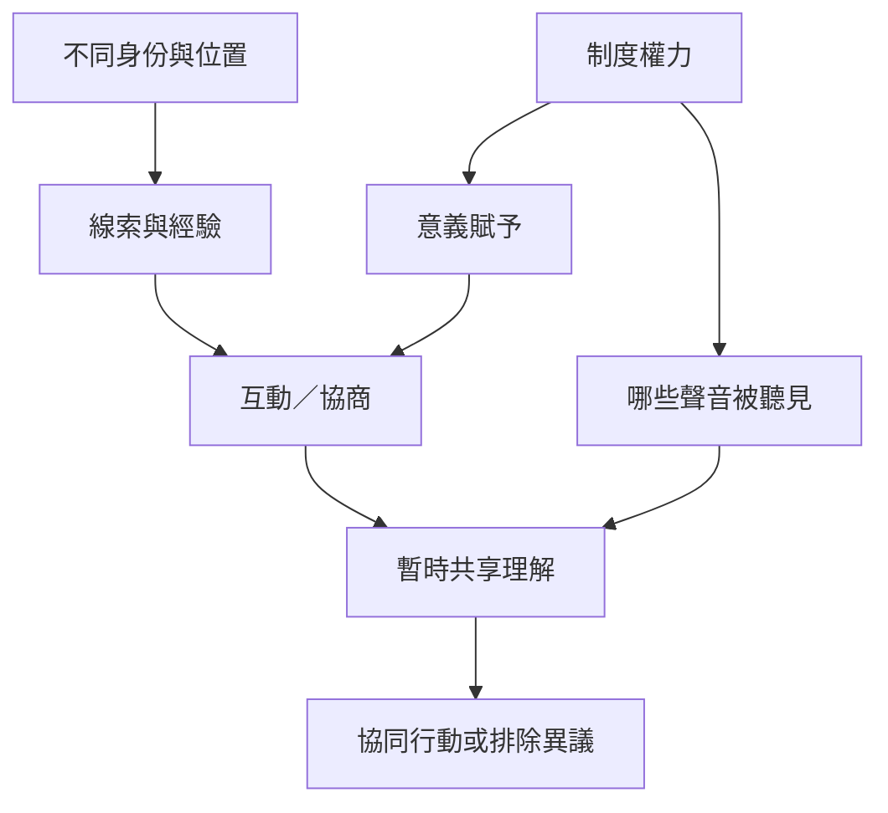

本圖將意義建構放入群體互動中：角色帶來不同線索，框架組織事件，意義賦予影響理解，而權力與參與條件決定哪些說法可以成為共同版本。

核心筆記：[[意義建構是社會互動而非個人腦內的獨立活動]]、[[意義賦予會擴大或收窄群體可採取的行動]]、[[框架決定人們如何辨識當下情境]]、[[知識生產中的權力影響哪些故事能成為公共事實]]。

概念：[[Sensegiving]]、[[Framing]]、[[Intersubjectivity]]、[[Distributed_cognition]]、[[Epistemic_justice]]。

文獻：[[《組織意義建構的社會過程》呈現領導者與利害關係人的互動差異]]、[[《框架分析》揭示人們如何回答「現在發生的是什麼事」]]、[[《社會世界的現象學》說明行動意義依賴生活世界與互為主體性]]。
