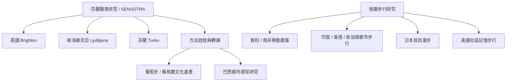

此地圖不把全球案例都說成 Sensobiographic Walking，而區分方法源流、直接延伸、相鄰方法與比較研究。芬蘭 Turku、英國 Brighton、斯洛維尼亞 Ljubljana 是 SENSOTRA 核心場域；葡萄牙與蘇格蘭案例明確表示受其啟發；巴西章節提供都市感官研究的轉譯線索；智利與南非提出移動敘事；印度、香港、新加坡與日本則提供感官步行、城市民族誌或音訊漫步的比較視角。

## 思與行
* 比較研究時標明方法是原始採用、局部改編、受啟發或相鄰研究。
* 加入更多亞洲、非洲與拉丁美洲的地方研究者著作，避免只以歐洲概念命名全球經驗。

## 參考
* 本卡片所屬書庫：[[Sensobiographic_walking]]
* [[SENSOTRA以跨世代散步追蹤三座歐洲城市的感官變遷]] · [[文化遺產研究將感官步行延伸為參與式敘事方法]] · [[巴西城市研究將感官生命史帶入都市感官研究]] · [[訪談中的移動本身會改變敘事節奏與互動]]
