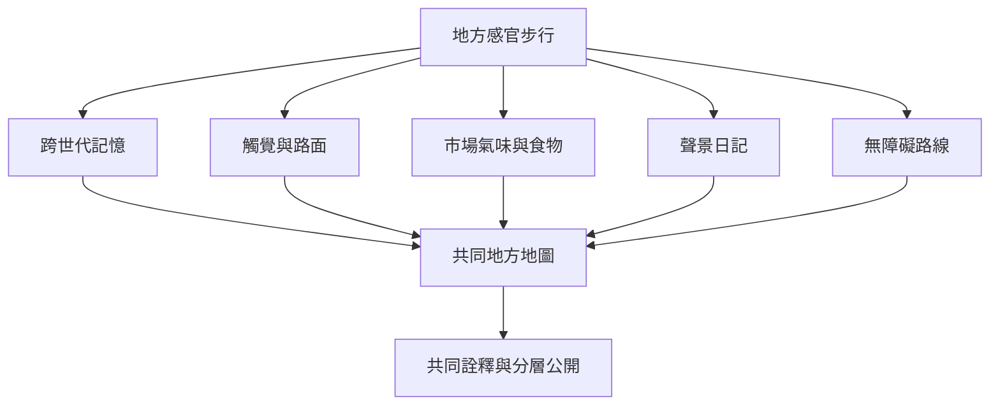

此地圖把方法知識轉化為可測試的小型田野實作：跨世代步行、赤腳觸覺記錄、市場氣味與食物記憶、聲景日記、參與者自選路線、無障礙設計與共同感官地圖。實作先從低風險、短路線與自願參與開始，再逐步建立資料保存與分享規則。

## 思與行
* 先試辦一條 30–45 分鐘的安全路線，參與者有完全改道與停止的權利。
* 每次活動只設定一個觀察焦點，避免把感官練習變成密集的資料採集。
* 產出由參與者共同決定公開範圍的地方感官地圖。

## 參考
* 本卡片所屬書庫：[[Sensobiographic_walking]]
* [[在台中設計跨世代感官散步以記錄城市變遷]] · [[以赤腳步行記錄路面觸感與公共基礎設施]] · [[用市場氣味與食物記憶研究續食文化]] · [[共製地方感官地圖並讓居民決定公開尺度]]
