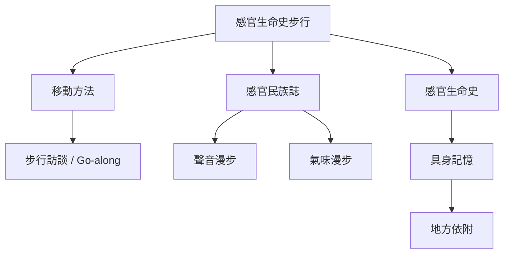

這張地圖整理感官生命史步行的核心方法，以及它和步行訪談、Go-along、感官民族誌、聲音漫步與氣味漫步的差異。核心問題不是「是否在走路」，而是研究如何把生命史、感官記憶與地方環境連成知識。可從 [[感官生命史步行把身體記憶帶回環境現場]] 和 [[步行訪談不必然等同感官生命史步行]] 開始。

方法比較需要連結 [[Walking_interview]]、[[Go_along]]、[[Mobile_methods]]、[[Soundwalk]]、[[Smellscape]]、[[Smellwalk]] 與 [[Multisensory_method]]。相關資料見 [[Go-Along訪談能在現場捕捉日常空間經驗]]、[[聲音漫步以聆聽重新開啟被忽略的環境]]、[[氣味漫步仍需要可比較且具倫理的研究程序]]。

## 思與行
* 用研究目的、參與者主導權、感官範圍、生命史關聯與資料型態五個面向比較方法。
* 將方法原型應用到台中時，明確標示哪些部分是改編。

## 參考
* [[Sensobiographic_walking]] · [[Walking_interview]] · [[Go_along]] · [[Sensory_ethnography]]
