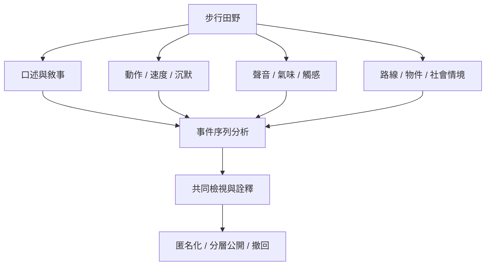

感官步行資料包含語言、沉默、身體動作、速度、路線、聲音、氣味與空間條件。這些資料可能揭露參與者的住居、社會關係、創傷或污名經驗，因此分析程序必須同時處理同意、匿名、可撤回、公共空間可見性與資料公開尺度。研究倫理不是事後補充，而是路線和資料生成方式的一部分。

相關概念包括 [[Situated_knowledge]]、[[Multisensory_method]]、[[Co_sensing]] 與 [[Sensory_commons]]。

## 思與行
* 建立可隨時休息、改道、停止或撤回片段的程序。
* 逐段記錄研究者提問與環境事件，避免把逐字稿視為完整資料。
* 公開前由參與者檢視可識別資訊與社群風險。

## 參考
* 本卡片所屬書庫：[[Sensobiographic_walking]]
* [[脆弱處境中的同行訪談需要重新評估倫理和照顧]] · [[行走資料需要把言語沉默姿態與環境一起分析]] · [[感官資料不能脫離權力無障礙與階級差異]]
