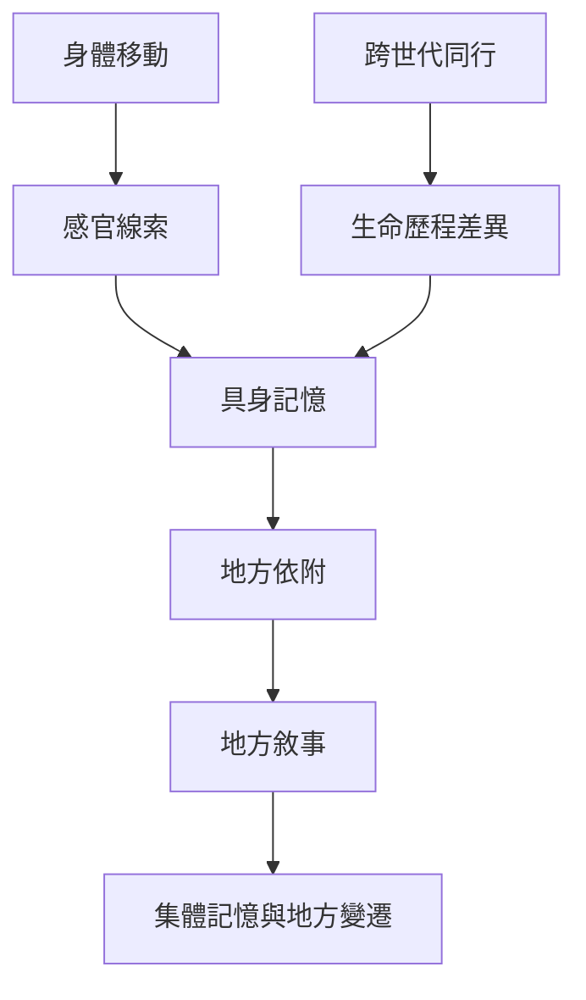

這張地圖整理身體如何在行走中感知地方，並透過感官線索喚起個人與集體記憶。跨世代同行讓不同生命歷程在同一條路線上相遇，呈現地方的多重時間。核心連結包括 [[步行使記憶透過環境線索在當下被喚起]]、[[跨世代同行讓城市成為不同時間經驗的交會處]] 與 [[地方是身體實踐與記憶不斷生成的關係]]。

延伸概念包含 [[Embodiment]]、[[Sensory_memory]]、[[Place_attachment]]、[[Intergenerational_methodology]]、[[Pace_and_rhythm]]。步速與都市設施的交互作用可延伸閱讀 [[note/步行節奏是身體與城市共同協商的結果]]，跨世代比較則見 [[note/跨世代方法把生命歷程帶入移動研究]]。

## 思與行
* 以同一地點的不同年代敘事，製作多聲部地方記憶圖。
* 將「沒有被想起」的場所與已消失的社會空間也納入訪談。

## 參考
* 本卡片所屬書庫：[[Sensobiographic_walking]]
* [[跨世代步行讓世代差異成為移動空間的研究材料]] · [[感官生命史步行把身體記憶帶回環境現場]] · [[美國黑人長者的地方記憶可由文化場所步行喚起]]
