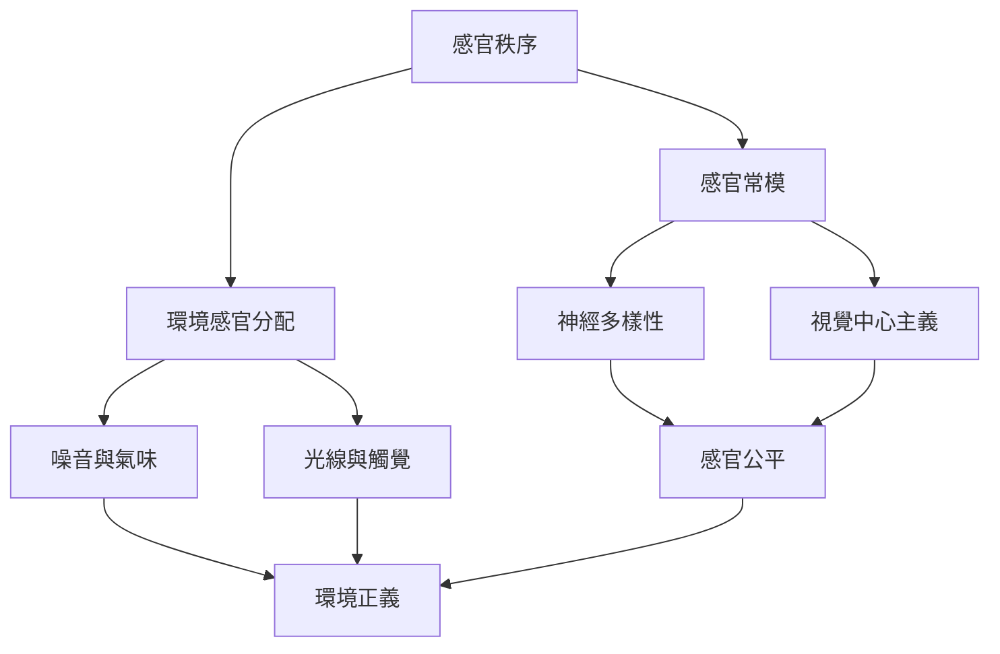

感官秩序會影響誰的感受被視為可靠、誰能舒適地使用公共空間，以及哪些刺激被定義為正常或噪音。此地圖把感官常模、神經多樣性、視覺中心主義與環境正義連結起來，將感官研究帶入制度與設計問題。

概念入口：[[感官秩序]]、[[感官公平]]、[[神經多樣性]]、[[環境正義]]、[[視覺中心主義]]。

永久筆記：[[視覺中心主義會塑造何者被視為知識]]、[[感官公平是環境與制度的設計問題]]、[[神經多樣性挑戰單一的感官常模]]、[[觸覺同時建立親密與社會界線]]。

研究材料：[[感官經驗與自閉症研究揭示感官常模的文化性]]、[[感官人類學挑戰西方五感模型與視覺中心主義]]。

延伸實作：[[讓跨感官展覽提供不同的參與路徑]]、[[以感官公平檢視城市環境的隱形負擔]]。

本主題導讀：[[Sensory_Anthropology]]。
